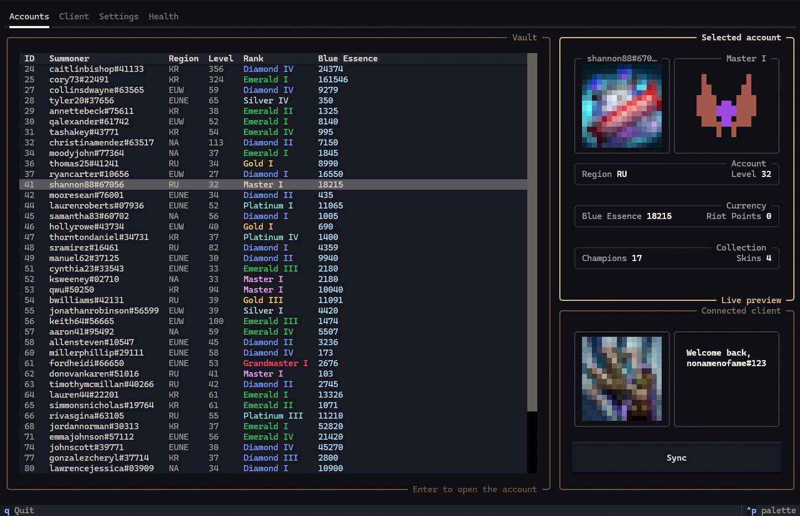

# Hexvault - League of Legends Accounts Vault
Software to store your league of legends accounts, private and open source.

Made for everyone who uses `.txt` files or google tables to store their accounts.



# Idea
Usually you store accounts in a `.txt` file like this:
```bash
# name#tag, region, level, etc.
login:password
```
Obviously enough - you will not be able to find sh*t in this format whenever you needed some **specific** account. The more you have - the more pain you will feel eventually.

This is how I got the idea of making my own account vault, some place where I could store not only the credentials and comments, but have **FULL DATA** about **each account**, name, tag, region, level, blue essence, champs, skins, loot - everything.

# Requirements
You'll need **[Python 3.14](https://www.python.org/downloads/release/python-3140/)** or higher and preferably a good terminal emulator, for windows users - **[Windows Terminal](https://aka.ms/terminal)**.

# Quick start
Step 1. Clone the repository:
```bash
git clone git@github.com:aASDa213ASD/hexvault.git
```

Step 2. Open **[install.cmd](install.cmd)**, wait until dependencies are installed

Step 3. Open **[launch.cmd](launch.cmd)**, done
