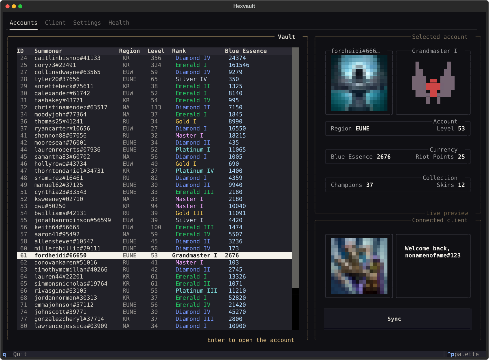

# Hexvault - League of Legends Accounts Vault
Software to store your league of legends accounts, private and open source.

Made for everyone who uses `.txt` files or google tables to store their accounts.



# Requirements
You'll need **[Python 3.14](https://www.python.org/downloads/release/python-3140/)** or higher and preferably a good terminal emulator, for windows users - **[Windows Terminal](https://aka.ms/terminal)**.

# Quick start
Step 1. Clone the repository:
```bash
git clone git@github.com:aASDa213ASD/hexvault.git
```

Step 2. Open **[install.cmd](install.cmd)**, wait until dependencies are installed

Step 3. Open **[launch.cmd](launch.cmd)**, done

# Idea
Usually you store accounts in a `.txt` file like this:
```bash
# name#tag, region, level, etc.
login:password
```
Obviously enough - you will not be able to find sh*t in this format whenever you needed some **specific** account. The more you have - the more pain you will feel eventually.

This is how I got the idea of making my own account vault, some place where I could store not only the credentials and comments, but have **FULL DATA** about **each account**, name, tag, region, level, blue essence, champs, skins, loot - everything.

# How it works
Current implementation uses **[Python](https://www.python.org/)** and heavily abuses **[Textual](https://textual.textualize.io/)** library for the whole TUI.

Software itself uses an authorized League of Legends Client, **[LCU](https://riot-api-libraries.readthedocs.io/en/latest/lcu.html)** to get a rich snapshot of current account and store it inside of **[SQlite3](https://sqlite.org/index.html)** database. For champions, skins, icons and any other resource from the game it uses **[CommunityDragon](https://www.communitydragon.org/)** as the main source of truth.

After syncing the account you will get a ton of information about it which can be inspected in a **[database models](src/database/models.py)** file.

# Manual LCU requests
The **Client** tab can open a preconfigured **[Posting](https://github.com/darrenburns/posting)** workspace for manual League Client and Riot Client requests. Hexvault keeps its own Textual dependency independent from Posting by creating an isolated Posting runtime under `var/posting/runtime` on first launch. Use **Open Posting** for a separate terminal window, or **Open Here** to temporarily suspend Hexvault and run Posting in the same terminal until Posting exits.

Request templates and current process credentials are generated under `var/posting/lcu`. The generated `lcu.env` file is ignored by git.
